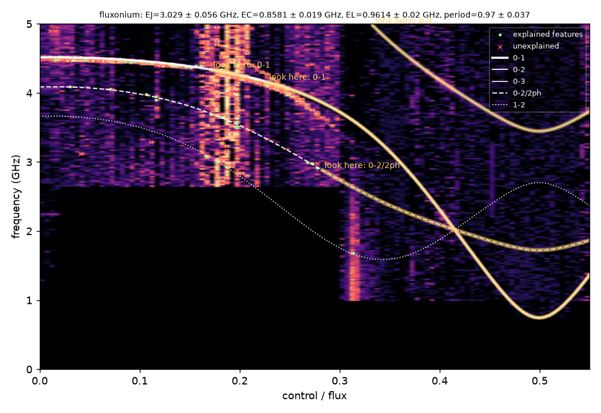
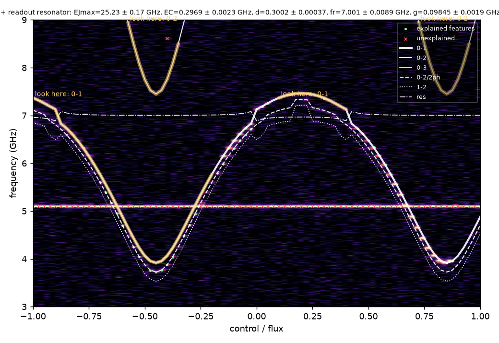

# CircuitSleuth

**Shazam for quantum chips.** Give it a two-tone spectroscopy map of a superconducting qubit and it tells you
*what circuit you built*, recovers the Hamiltonian parameters and the flux calibration, overlays the fitted
transitions live, lists every feature it **cannot** explain, and tells you **where to measure next**.

Built in 36 hours at Cal Hacks 13.0 (Oct 2026).



*Above: a published fluxonium spectroscopy map (Nguyen et al., PRX 9, 041041, 2019, device A), digitised
from the paper's vector PDF. CircuitSleuth was told nothing except "this is a map between 0 and 5 GHz".*



*A hidden tunable transmon crossing a 7 GHz readout resonator, with a pump spur at 5.1 GHz. The bare circuit
could not explain the bend near 7 GHz, so the agent hypothesised a resonator there: EJmax, EC, d, fr, g and
the flux period all come back within 1 % (precomputed result shipped with the app).*

## Not just circuit QED

The pipeline is "spectrum versus a control knob, explained by a small Hamiltonian", so other platforms plug
in as families. Two are included beyond superconducting circuits:

| platform | measurement | model | parameters recovered |
|---|---|---|---|
| NV centres in diamond | ODMR lines vs coil current | S = 1 Hamiltonian D Sz² + E(Sx² − Sy²) + γ B·S for the four ⟨111⟩ orientations | D, E, field direction (θ, φ), gauss per unit current, zero-field current |
| Semiconductor double quantum dot | charge-qubit spectroscopy vs detuning gate | f = √(ε² + (2 t_c)²), ε = lever arm × (V − V₀) | tunnel coupling t_c, lever arm, detuning zero |

On hand-picked hidden maps both come back to better than 1 % (`tests/test_platforms.py`); on random
hidden maps (`python demo.py --platform nv|dot`) the family is always identified and every parameter is
within tolerance in 6 of 8 (NV) and 5 of 8 (quantum dot) cases, the misses being maps with fewer than
about twenty usable features, which the report flags as low confidence. Adding a
platform means writing its transition frequencies in `models.py` and declaring its control axis; the
extraction, robust fitting, hold-out verification, unexplained-feature and next-measurement logic are shared.

## Why

Every superconducting-qubit lab does this by hand: stare at a spectroscopy map, guess the circuit, open
scqubits or a home-made script, tweak EJ/EC/EL until the lines land on the data, argue about which
features are pump leakage, then decide what to sweep next. It takes hours to days per device and it is the
first thing you do with every new chip. CircuitSleuth automates the whole loop, and keeps the parts a
physicist needs: honest uncertainties, explicit unexplained features, and a verification step that never
sees the data it is tested on.

## What it does

1. **Feature extraction.** Robust per-column peak finding (noise estimated per flux column, so streaky
   real data does not flood the point cloud), sub-pixel refinement, linking of points into line
   segments ("tracks"), and detection of flux-independent lines (pump / LO / mixer spurs).
2. **Hypotheses.** Three circuit families (fixed transmon, flux-tunable transmon, fluxonium), each with or
   without a readout resonator. A tiny CNN trained on synthetic maps *proposes* families and seeds; it
   never reports a number.
3. **Physics fit.** Fast batched NumPy Hamiltonians (checked against scqubits to 1e-6 GHz in the test
   suite). The loss is Geman–McClure on the distance of every observed feature to the nearest predicted
   transition line (0-1, 0-2, 0-3, two-photon 0-2/2, thermal 1-2, dressed by the resonator when present),
   so spurious lines cost a bounded amount instead of bending the fit. Global search = differential
   evolution with an annealed robust scale; local polish = soft-L1 least squares; uncertainties from the
   Jacobian. The flux axis is **not** assumed calibrated: period and offset (in volts / mA) are fitted,
   seeded by a symmetry analysis (every flux-tunable spectrum is mirror-symmetric about Φ = 0 and Φ = ½).
4. **Verification.** Every candidate is scored by the fraction of *features* (not pixels) it explains, then
   re-fitted on 70 % of the flux columns and scored on the untouched 30 %.
5. **Revision.** If the best bare circuit leaves a cluster of unexplained flux-dependent points, the agent
   seeds a resonator hypothesis at that frequency (that is what an avoided crossing looks like) and tries
   again.
6. **Report.** Parameters ± σ, hold-out score, every hypothesis tried, unexplained features with a
   physical interpretation, and "where to look next": predicted lines with no data under them, lines just
   outside the band, and which transition would pin down a poorly determined parameter. Claude (Opus 5.5,
   structured output) turns the JSON into a plain-English summary; a template does the same without a key.

## Run it

```bash
python3.12 -m venv .venv && . .venv/bin/activate
pip install -e .
pytest -q                       # physics vs scqubits, extraction, fitting, end-to-end agent
streamlit run app.py            # UI with demo circuits, CSV / NPZ / screenshot upload
python demo.py --n 12           # blind test on random hidden circuits
python scripts/run_real.py data/demo/nguyen2019_devA.npz   # the published fluxonium map
```

Optional: `ANTHROPIC_API_KEY=...` in `.env` enables the Claude explanation layer;
`python scripts/train_classifier.py` (re)trains the CNN proposer on synthetic maps.

## Results

See `artifacts/` after running `demo.py` and `scripts/run_real.py`. (Filled in below before submission.)

### Real data: Nguyen et al. (2019) fluxonium, device A

Input: Fig. 2 of the paper digitised from the vector PDF (`scripts/prep_nguyen2019.py`); the right half of
the published map is too noisy for any feature to survive extraction, so only the 0-1 line from Φ = 0 to
about 0.3 and fragments of 0-2 are available. With the paper's flux axis (period held at 1):

| parameter | CircuitSleuth | paper's fit |
|---|---|---|
| EJ | 3.23 ± 0.20 GHz | 3.0 GHz |
| EC | 0.80 ± 0.05 GHz | 0.84 GHz |
| EL | 0.98 ± 0.04 GHz | 1.0 GHz |

Without the axis prior the period is unconstrained by this half-map (the fit reports it and asks for a sweep
near Φ = ½ below 1.2 GHz, which is exactly where the paper's inset lives).


### Hand-picked scenarios (`tests/test_agent.py`, run end to end with no proposer)

| hidden circuit | result |
|---|---|
| tunable transmon through a 7 GHz resonator + a 5.1 GHz pump spur | family + resonator found; EJmax, EC, d, fr, g, flux period all within 1 %; spur reported as unexplained flux-independent line |
| fluxonium (EJ 6, EC 1, EL 0.6) | all three energies within 0.3 %; a trial resonator model rejected (gain below margin) |
| fixed transmon + LO leakage | family found, EC within 1 % |
| tunable transmon, band too narrow to show the two-photon line | EJ–EC degeneracy flagged; "look here" asks for the 0-2/2ph line |

### Blind test (`demo.py`, 10 random hidden circuits from the synthetic generator, harsh settings: up to 3 spurs, dropouts, noise up to 10 %)

Family identified in 6 of 10. Both flux-tunable circuits without a resonator were recovered to ≤ 1.2 % in
every parameter including the flux period. Fixed transmons were always recognised, but when the generator
dropped the two-photon line only f01 is observable and EJ/EC come back with large stated uncertainties.
The failures are tunable-transmon-plus-resonator maps mistaken for fluxonium (two cases) and one very
faint fluxonium: these are the cases we would want more data for, and the report says so. Mean runtime in
that run was 9 min per map because the test shared the laptop with the test suite; alone, with four workers,
a map takes about 2 min with the 'fast' preset and 5–6 min with 'normal' (which is what the saved demo results use).

### Proposer (CNN on 64×64 thumbnails, 20 000 synthetic maps, held-out 2 000)

Family accuracy 86 %, resonator-present accuracy 55 % (near chance: a resonator is invisible unless the
qubit crosses it), so the network is only used to rank families and seed the search.


## Honest limitations

- Three circuit families. Adding one means writing its Hamiltonian in `models.py` and a scqubits test.
- No signal, no answer: the fitter needs visible lines. Given partial lines it reports where to look.
- Very noisy maps with few features can be genuinely ambiguous between a tunable transmon and a
  high-EL fluxonium; the report shows both scores instead of hiding it.
- Trained proposer and all tests use synthetic data; the only real map is the digitised figure above.

## Layout

```
circuitsleuth/models.py    Hamiltonians, transitions (validated against scqubits)
circuitsleuth/synth.py     synthetic maps with realistic nuisances; CNN training data
circuitsleuth/extract.py   peaks, tracks, flat lines, symmetry-based flux calibration
circuitsleuth/fit.py       robust global+local fit, uncertainties, hold-out check
circuitsleuth/classify.py  CNN proposer (torch)
circuitsleuth/agent.py     orchestration: propose -> fit -> verify -> revise -> report
circuitsleuth/explain.py   Claude explanation (structured output) with template fallback
app.py                     Streamlit UI;  demo.py  blind test;  tests/  pytest suite
```

Figure 2 of Nguyen et al. is reproduced under the arXiv non-exclusive license for demonstration.
